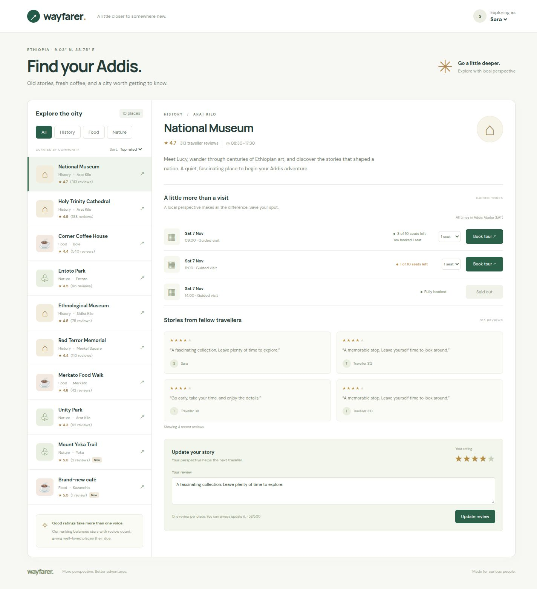

# Wayfarer — Find your Addis

A full-stack city guide for Addis Ababa, built with React, Vite, Express and SQLite. Browse ten places, filter by category, read and update reviews, switch between three demo travellers, and reserve guided tours. Ranking considers review volume; booking capacity is protected by database transactions and constraints.

## Run locally — three commands

Prerequisites: Node.js 20.19+ (tested on 20.20.2), npm, and an available port 3000. From the repository directory:

```sh
npm ci
npm run seed
npm run dev
```

Open http://localhost:3000. No environment variables, accounts, API keys or external database are needed. SQLite data persists under ignored `data/`. The seed command is repeatable and preserves existing data. A fresh database has three museum tours with 4, 1 and 0 seats left. Demo users are Sara, Abel and Liya; historical reviewers are not selectable.

`better-sqlite3` normally installs a prebuilt binary. Platforms without a matching binary need Python and a C/C++ build toolchain. Optional Google Fonts have local sans-serif fallbacks; application behavior does not depend on a font request succeeding.

## Test

```sh
npm test
```

Tests use isolated temporary databases and do not alter the local app’s data:

- Ranking unit test: an established 4.7-star place outranks one or two perfect reviews; empty and large samples behave sensibly.
- Parallel booking test: 40 requests across four independent HTTP server processes compete for one seat. Also tests multi-seat capacity, 20 identical concurrent retries, invalid quantities, and database constraint guards.
- API integration test: backend category filtering, SQL/JavaScript ranking agreement, updating one review without duplication, invalid ratings and user rejection, and repeatable seeding.

Production build: `npm run build`, then `npm start` (uses the same seeded SQLite file). The development command serves Vite and the API from one origin; production serves built assets through Express.

## Preview



## Structure

- `server/db.js`: schema, integrity checks and connection setup.
- `server/ranking.js`: documented ranking formula and SQL expression.
- `server/bookings.js`: transactional booking service and replay handling.
- `server/app.js`: validated HTTP endpoints.
- `server/seed.js`: deterministic fictional reviews and relative future tours.
- `src/useWayfarer.js`: client requests, state, loading and mutations.
- `src/PlacesList.jsx`, `src/PlaceDetail.jsx`: explorer and place details.
- `tests/`: Node test runner, HTTP integration and multiprocess concurrency.

See [DECISIONS.md](DECISIONS.md) for ranking, concurrency and tradeoffs, and [AI_USAGE.md](AI_USAGE.md) for AI assistance and verification.

## API

All routes except `GET /api/users` require `X-User-Id: 1`, `2`, or `3`.

| Method and route                        | Purpose                                                                                       |
| --------------------------------------- | --------------------------------------------------------------------------------------------- |
| `GET /api/users`                        | Three selectable travellers                                                                   |
| `GET /api/places?category=All&sort=top` | Backend filtering and ranking; categories: All, History, Food, Nature                         |
| `GET /api/places/:id`                   | Summary, recent reviews, current user’s review, upcoming slots and booked seats               |
| `PUT /api/places/:id/review`            | `{ "rating": 5, "body": "A memorable visit" }`; inserts or updates                            |
| `POST /api/slots/:id/bookings`          | `{ "seats": 1 }` with a unique `Idempotency-Key` header; 201 new, 200 replay, 409 unavailable |

## Known limitations

This is a local demonstration with an intentionally unauthenticated user switcher, bound to loopback. Place descriptions, hours, ratings and tours are illustrative, not verified travel information. No cancellations, payments, search, user creation, or review pagination. The page shows four recent reviews. Availability refreshes after successful actions or manual Refresh; a competing booking is rechecked on the server. After seeded tour dates pass, tours disappear; a fresh database seeds future dates. SQLite assumes local disk and a small workload. Database schema upgrades are not versioned migrations yet. Client retry keys do not survive a reload. No remote hosting or repository remote has been configured.
